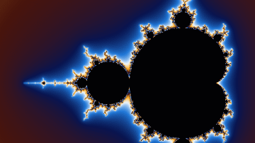
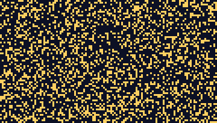

# ferrompeg

A small multimedia toolkit written from scratch in pure Rust, with a command
line that follows the familiar `ffmpeg` conventions.


```sh
ferrompeg -i input.wav output.flac
ferrompeg -f lavfi -i "mandelbrot=duration=4" -vf "scale=360:-2" zoom.gif
ferroprobe -show_streams -of json output.flac
```

ferrompeg is not a replacement for FFmpeg and is not affiliated with it. It
covers a deliberately small set of formats, and every one of them is
implemented from its published specification.

## Why

- **Memory safe by construction.** No `unsafe` code. Buffer overflows and
  use-after-free bugs, the most common class of vulnerabilities in media
  parsers, cannot happen here, which matters when you process files you did
  not create.
- **Zero dependencies.** Every container, codec and filter is in this
  repository. No C library to build, no supply chain to audit, one binary of
  about 1 MB that builds anywhere Rust does.
- **Permissive license.** MIT or Apache-2.0, so it can be embedded in any
  product.
- **Readable.** The whole pipeline (demuxer, decoder, filters, encoder, muxer)
  fits in about 26,000 lines that can be read in order. A good base to learn
  how audio and video processing works.
- **Familiar.** Same options as the tool everyone knows: `-i`, `-ss`, `-t`,
  `-af`, `-vf`, `-c copy`, `-f lavfi`, plus `ferroprobe` for inspection.

## Gallery

Both animations were generated and encoded by ferrompeg itself:

| `mandelbrot` source | `life` source |
| --- | --- |
|  |  |

```sh
ferrompeg -f lavfi -i "mandelbrot=s=480x270:r=12:d=4" -vf "scale=360:-2:flags=area" docs/mandelbrot.gif
ferrompeg -f lavfi -i "life=s=120x68:r=8:d=5" -vf "scale=360:-2:flags=neighbor" docs/life.gif
```

## Install

```sh
cargo install --git https://github.com/pcangemi/ferrompeg
```

This installs two binaries, `ferrompeg` and `ferroprobe`. Rust 1.85 or newer
is required.

## What it supports

| | |
| --- | --- |
| **Audio containers** | WAV (including WAVE_FORMAT_EXTENSIBLE), AIFF and AIFF-C, Sun AU, native FLAC, headerless PCM (`s16le`, `f32be` and 12 other layouts) |
| **Video containers** | YUV4MPEG2 (`.y4m`), headerless raw video, animated GIF (output), PPM, PGM and BMP image sequences (output) |
| **Audio codecs** | FLAC (encoder and decoder), PCM from 8 to 64 bit, integer and float, both byte orders, G.711 A-law and mu-law |
| **Video codecs** | raw video (yuv420p, yuv422p, yuv444p, gray, rgb24), GIF (encoder) |
| **Audio filters** | `volume`, `aresample`, `aformat`, `afade`, `lowpass`, `highpass`, `atempo`, `areverse` |
| **Video filters** | `scale`, `crop`, `pad`, `hflip`, `vflip`, `transpose`, `format`, `fps`, `negate`, `eq`, `boxblur` |
| **Sources** (`-f lavfi`) | `sine`, `anullsrc`, `anoisesrc`, `testsrc`, `smptebars`, `color`, `mandelbrot`, `life` |

Run `ferrompeg -formats`, `-codecs` or `-filters` for the full lists.

## Examples

```sh
# Lossless archive and back, bit for bit
ferrompeg -i recording.wav recording.flac
ferrompeg -i recording.flac -c:a pcm_s24le restored.wav

# Speech recognition input: a 45 second cut, 16 kHz mono, filtered and louder
ferrompeg -i interview.flac -ss 00:01:30 -t 45 -af "highpass=f=80,volume=3dB" -ar 16000 -ac 1 clip.wav

# A 3 minute song 25% faster without changing pitch, fading out at the end
ferrompeg -i song.wav -af "atempo=1.25,afade=t=out:st=140:d=4" faster.wav

# Video frames to images, a crop to a looping GIF
ferrompeg -i clip.y4m -vf "scale=iw/2:-2" -frames:v 10 frame%03d.ppm
ferrompeg -i clip.y4m -vf "crop=320:240,fps=12" -loop 0 clip.gif

# Raw PCM in, FLAC out, through pipes
ferrompeg -f s16le -ar 48000 -ac 2 -i - -f flac - < capture.raw > capture.flac

# Test signals for a CI or a measurement bench
ferrompeg -f lavfi -i "anoisesrc=color=pink:duration=10" pink.wav
ferrompeg -f lavfi -i "smptebars=size=1280x720:duration=5" bars.y4m

# Inspect a file, as JSON for scripts
ferroprobe -show_format -show_streams -of json recording.flac
```

Time values accept seconds (`5`, `1.5`, `250ms`) or `[HH:]MM:SS[.xx]`. Options
placed before `-i` apply to the input, options before an output file apply to
that output, and several outputs can be written in one run.

## How it is tested

- More than 400 unit tests, plus end-to-end tests that run the binaries.
- During development every format was checked against the reference tools,
  used as black boxes: files written by ferrompeg are read back by `ffprobe`,
  `ffmpeg` and `flac -t` with identical samples, and files written by those
  tools are decoded by ferrompeg bit for bit. Small fixtures produced that way
  are committed under `tests/fixtures/`, so the test suite itself needs no
  external tool.
- Malformed input returns an error instead of panicking, and allocations
  driven by header fields are capped.

## Performance

Correct first, fast enough second. On an Apple Silicon laptop, for two minutes
of 16-bit stereo audio:

| | ferrompeg | reference `flac -5` |
| --- | --- | --- |
| FLAC encode | 1.06 s | 0.20 s |
| FLAC decode | 0.21 s | 0.13 s |
| Output size | 7,134,512 bytes | 7,134,013 bytes |

Compression matches the reference encoder within 0.01%, while encoding is
about five times slower. Mature media tools owe most of their speed to
hand-tuned SIMD code; ferrompeg has none yet, which leaves room to improve.

## Limitations

- No MP3, AAC, Opus, H.264 or other lossy compressed codecs, and no MP4,
  Matroska or Ogg containers. Most consumer media therefore needs another tool.
- One input per run, single source graphs for `-f lavfi`, constant frame rate
  video only, YUV in BT.601 limited range.
- WAV output is limited to 4 GiB (no RF64).

## Roadmap

- MP3 decoder
- MP4 (ISO BMFF) demuxer
- WebAssembly build for in-browser conversion
- SIMD paths for the FLAC encoder, the resampler and the scaler

## Architecture

See [docs/architecture.md](docs/architecture.md) for how the pipeline is put
together and where each format lives.

## License

Licensed under either of

- Apache License, Version 2.0 ([LICENSE-APACHE](LICENSE-APACHE))
- MIT license ([LICENSE-MIT](LICENSE-MIT))

at your option.

Unless you explicitly state otherwise, any contribution intentionally
submitted for inclusion in the work by you, as defined in the Apache-2.0
license, shall be dual licensed as above, without any additional terms or
conditions.
